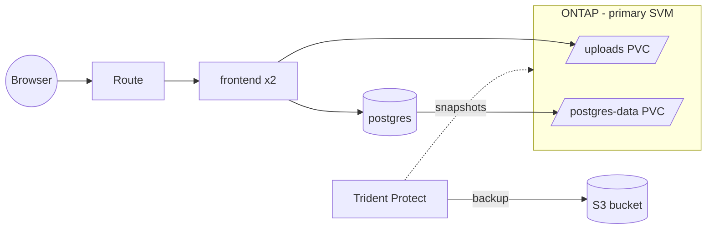
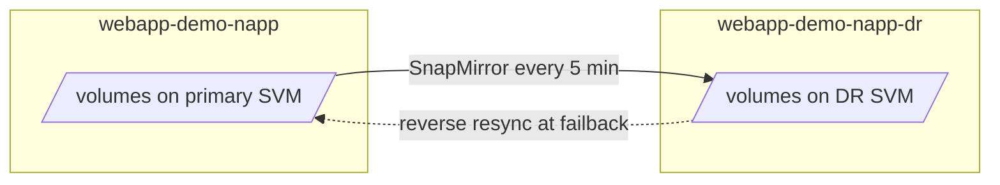

# Trident Protect demo on OpenShift: backup, restore and SnapMirror DR

A small web app on OpenShift with its data on NetApp ONTAP, to demonstrate
application-aware data protection with **NetApp Trident Protect**:

1. **Backup & restore** to S3: after data loss, and after losing the whole namespace
2. **Disaster recovery** with SnapMirror to a second SVM: failover, and failback with a
   reverse resync

The app stores notes in PostgreSQL and uploaded files on a shared volume. Every page
shows how many notes and files exist, so you can show the data before the disaster,
after it, and after the restore.



Every step is a YAML file you `oc apply -f`. Files with a `${PLACEHOLDER}` need a value
from your environment or the cluster; each file's header says where to get it. The
[scripts](#scripts) run the same steps with the same files.

## Layout

```
app/webapp.yaml          the demo app
setup/                   Trident, Trident Protect, backup bucket (once)
backup/                  demo 1: backup & restore
dr/setup/                DR backend, storage class, DR bucket (once)
dr/                      demo 2: replication, failover, failback
scripts/                 the same steps, automated
```

## Prerequisites

- OpenShift 4.x with cluster-admin access, `oc` and `helm`
- NetApp ONTAP with an SVM for NFS (the *primary SVM*), reachable from the worker nodes
- An S3 bucket provider. The files use OpenShift Data Foundation's Multicloud Object
  Gateway (storage class `openshift-storage.noobaa.io`)
- Pods need internet access: the frontend installs its Python packages at startup

Tested with OpenShift 4.22, Trident 26.06 and Trident Protect 26.06.

> Several resource kinds exist more than once on a typical cluster (`Backup` and
> `Schedule` for Velero/OADP, `Application` for Argo CD), so the commands use full names
> such as `backups.protect.trident.netapp.io`.

## Setup

```bash
# Trident (skip 1-2 if Trident is already installed)
oc apply -f setup/1-trident-operator.yaml
oc apply -f setup/2-trident-orchestrator.yaml
oc apply -f setup/3-ontap-credentials.yaml            # placeholders
oc apply -f setup/4-trident-backend-primary.yaml      # placeholders
oc apply -f setup/5-storageclass-primary.yaml

# Trident Protect
helm repo add netapp-trident-protect https://netapp.github.io/trident-protect-helm-chart
helm upgrade --install trident-protect netapp-trident-protect/trident-protect \
  --version 100.2606.0 -n trident-protect --create-namespace -f setup/trident-protect-values.yaml
oc apply -f setup/6-volumesnapshotclass.yaml
oc apply -f setup/7-backup-bucket.yaml
oc apply -f setup/8-appvault.yaml                      # placeholders

# The app
oc apply -f app/webapp.yaml
oc get route frontend -n webapp-demo-napp
```

If you already have Trident, your storage class for the app must be called `ontap-nas-sc`
and, for the DR demo, select only the primary backend (see `setup/5-storageclass-primary.yaml`).

## Demo 1: Backup & restore

1. **Add data** in the app: a few notes and a file.
2. **Protect the app** (everything in the namespace):
   ```bash
   oc apply -f backup/1-application.yaml
   ```
3. **Snapshot** (optional): instant ONTAP snapshots plus the app's resources.
   ```bash
   oc apply -f backup/2-snapshot.yaml
   ```
4. **Backup** to S3:
   ```bash
   oc apply -f backup/3-backup.yaml
   oc get backups.protect.trident.netapp.io -n webapp-demo-napp -w          # until Completed
   oc get backups.protect.trident.netapp.io webapp-backup-1 -n webapp-demo-napp \
     -o jsonpath='{.status.appArchivePath}{"\n"}'                           # needed to restore
   ```
5. **Disaster**, either data loss:
   ```bash
   oc exec -n webapp-demo-napp deploy/postgres -- psql -U webapp -d notes -c 'DELETE FROM notes;'
   oc exec -n webapp-demo-napp deploy/frontend -- sh -c 'rm -f /data/uploads/*'
   ```
   or losing the whole namespace:
   ```bash
   oc delete namespace webapp-demo-napp
   ```
6. **Restore** (fill in `${ARCHIVE_PATH}` from step 4):
   ```bash
   oc apply -f backup/4a-restore-inplace.yaml       # after data loss
   oc apply -f backup/4b-restore-full.yaml          # after losing the namespace
   oc get backupinplacerestores.protect.trident.netapp.io,backuprestores.protect.trident.netapp.io \
     -n webapp-demo-napp -w                         # until Completed
   ```
   The app is down during the restore (a few minutes). Reload the page afterwards.

## Demo 2: Disaster recovery with SnapMirror

The app is replicated every 5 minutes to a namespace `webapp-demo-napp-dr` whose volumes
are on a second SVM. Failover takes about a minute; failback sends back only the changes
made at the DR site.



### ONTAP requirements

The *DR SVM* is a second, writable SVM (on the same or another ONTAP cluster) with:

- SVM peering to the primary SVM (`vserver peer show`) and a SnapMirror license
- Aggregates assigned, NFS enabled and an NFS data LIF
- A route to the worker nodes (routes are per SVM, a new SVM has none)
- An export-policy rule allowing the worker nodes with root access (a new SVM's `default`
  policy has no rules)

You don't create SnapMirror relationships yourself: Trident Protect creates them.

### Setup

```bash
oc apply -f dr/setup/1-trident-backend-dr.yaml   # placeholders
oc apply -f dr/setup/2-storageclass-dr.yaml
oc apply -f dr/setup/3-dr-bucket.yaml
oc apply -f dr/setup/4-appvault-dr.yaml          # placeholders
```

### 1. Start replication

```bash
oc apply -f dr/1-dr-namespace.yaml
oc apply -f dr/2-source-snapshot-schedule.yaml
oc apply -f dr/3-appmirrorrelationship.yaml     # placeholder: source app UID
oc get appmirrorrelationships.protect.trident.netapp.io -n webapp-demo-napp-dr -w   # until Established
```

The mirror replicates the source app's latest snapshot, so the snapshot schedule is required.

### 2. Failover

Add a note and wait for the next replication (up to 5 minutes;
`.status.lastTransferredSnapshot` on the AppMirrorRelationship shows the latest). Then:

```bash
# disaster at the primary site
oc scale deploy --all -n webapp-demo-napp --replicas=0

# stop the source snapshot schedule, so the last replicated snapshot is kept for failback
oc patch schedules.protect.trident.netapp.io webapp-replication-schedule -n webapp-demo-napp \
  --type merge -p '{"spec":{"enabled":false}}'

# promote the DR copy
oc patch appmirrorrelationships.protect.trident.netapp.io webapp-demo-napp-mirror -n webapp-demo-napp-dr \
  --type merge -p '{"spec":{"desiredState":"Promoted"}}'
oc get appmirrorrelationships.protect.trident.netapp.io -n webapp-demo-napp-dr -w   # until Promoted

# give the DR app its own URL (the replicated Route has the primary's hostname)
oc delete route frontend -n webapp-demo-napp-dr
oc apply -f dr/4-route-dr.yaml
oc get route frontend -n webapp-demo-napp-dr
```

The app now runs on the DR SVM. Add a note there to show it coming back at failback.

### 3. Failback

```bash
# stop writes at the DR site
oc scale deploy --all -n webapp-demo-napp-dr --replicas=0

# reverse resync DR -> primary (placeholders: DR volume handles)
oc apply -f dr/5-reverse-resync.yaml
oc get tridentmirrorrelationships.trident.netapp.io -n webapp-demo-napp -w     # until reestablished

# make the primary volumes writable and start the app
oc patch tridentmirrorrelationships.trident.netapp.io postgres-data uploads -n webapp-demo-napp \
  --type merge -p '{"spec":{"state":"promoted"}}'
oc get tridentmirrorrelationships.trident.netapp.io -n webapp-demo-napp -w     # until promoted
oc scale deploy/postgres -n webapp-demo-napp --replicas=1
oc scale deploy/frontend -n webapp-demo-napp --replicas=2
```

The app is back on its original URL and volumes, including the note written at the DR site.

### 4. Re-protect

```bash
oc delete tridentmirrorrelationships.trident.netapp.io --all -n webapp-demo-napp
oc delete namespace webapp-demo-napp-dr
```

Then repeat [1. Start replication](#1-start-replication).

## Scripts

`scripts/` runs the steps above with the same YAML files and fills in the placeholders.

| Script | Steps |
|---|---|
| `install-trident.sh` | setup 1-5 (env: `ONTAP_USERNAME ONTAP_PASSWORD MANAGEMENT_LIF PRIMARY_SVM PRIMARY_DATA_LIF`) |
| `install-trident-protect.sh` | Helm install, setup 6-8 (optional env: `CLUSTER_NAME`) |
| `reset.sh` | delete the app namespace, deploy a fresh app + Application |
| `backup.sh` | backup; saves the archive path to `.last-backup` |
| `restore.sh inplace\|full [path]` | restore from `.last-backup` or the given path |
| `dr-setup.sh` | dr/setup (env: `MANAGEMENT_LIF DR_SVM DR_DATA_LIF`) |
| `dr-start-mirror.sh` | replication |
| `dr-failover.sh` | failover |
| `dr-failback.sh` | failback |
| `dr-reprotect.sh` | re-protect |

## Notes

- **Trident Protect's SCC.** The backup jobs need the `trident-protect-job` SCC. OpenShift
  gives a pod the highest-priority SCC it may use, and other operators (e.g. OpenShift AI)
  add SCCs with a higher priority than the default of 1. `setup/trident-protect-values.yaml`
  therefore sets `scc.priority: 20`. Don't work around backup failures by granting `anyuid`.
- **Fixed UIDs.** OpenShift gives each new namespace its own UID range. The app runs with
  fixed UIDs (`nonroot-v2` SCC) so restored data stays readable in a recreated or DR
  namespace.
- **Failback needs a common snapshot.** The reverse resync starts from the last snapshot
  both SVMs share. That's why the source snapshot schedule is stopped at failover;
  otherwise its retention deletes that snapshot. Without it, ONTAP reports
  `No common snapshot found` and the only way back is a full copy.
- **Crash-consistent.** Snapshots are taken without pausing PostgreSQL. For production,
  add a Trident Protect `ExecHook` that runs `CHECKPOINT` first.
- **Backup location.** For real protection, the S3 bucket and the DR AppVault belong outside
  the cluster you're protecting.
- `app/webapp.yaml` contains a demo database password. For labs only.
